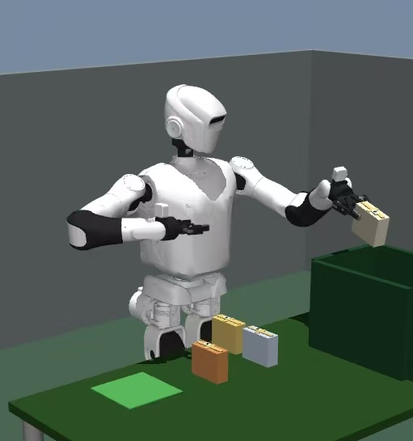
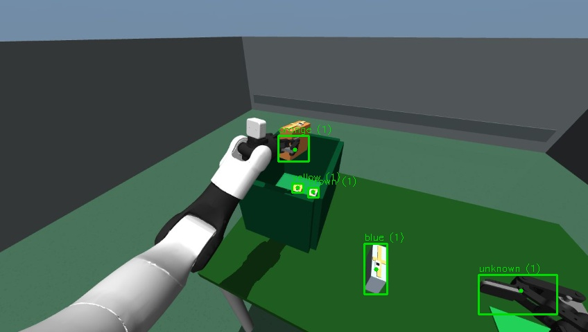
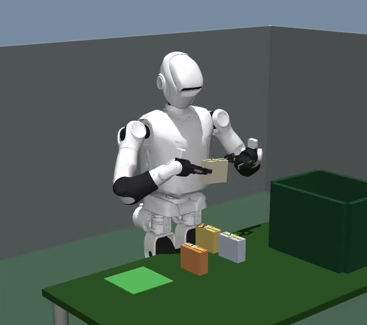
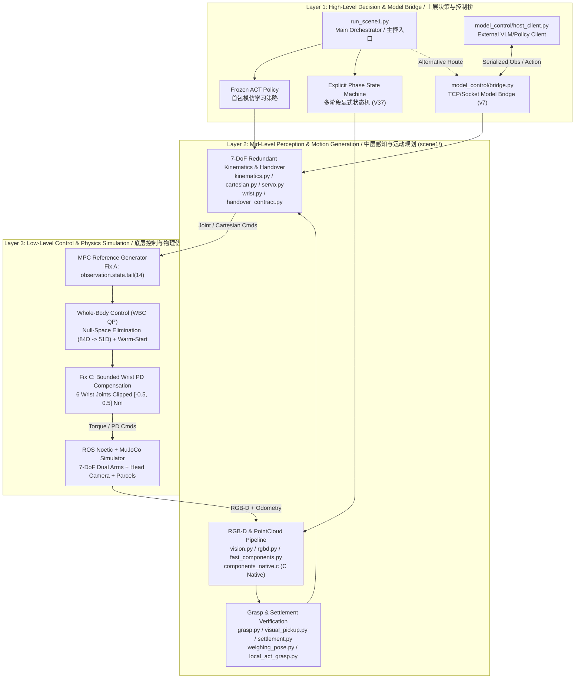

# Scene1-AC-v1: Dual-Arm Parcel Manipulation System / 双臂机器人四包裹连续分拣与操作系统


> **写在前面 / Developer's Note**
>
> 欢迎来到 [Krist21a/scene1-ac-v1](https://github.com/Krist21a/scene1-ac-v1)！这是我在攻克 **Scene1 双臂机器人连续四包裹操作任务** 过程中的完整研发仓库与工作站代码归档（最新快照标签为 [scene1-latest-20261115](https://www.google.com/search?q=https://github.com/Krist21a/scene1-ac-v1/tags)）。这里不仅保存了从一代基线 `ac-v1-20261025`（约 34.5 分钟完赛）一路优化到 `ac-v1-speed-20261026`（14 分钟级完赛）再到 600 秒级传统策略（V37）与模型控制桥（v7）的全套代码，也记录了我在这套复杂双臂系统里踩过的无数“深坑”。
>
> Welcome to [Krist21a/scene1-ac-v1](https://github.com/Krist21a/scene1-ac-v1)! This repository archives my ongoing engineering journey tackling the **Scene1 Dual-Arm Four-Parcel Continuous Manipulation Task** in MuJoCo + ROS Noetic (latest snapshot tag: [scene1-latest-20261115](https://www.google.com/search?q=https://github.com/Krist21a/scene1-ac-v1/tags)). It houses everything from the Generation-1 baseline (`ac-v1-20261025`, ~34.5 min completion) and the sub-15-minute speed milestone (`ac-v1-speed-20261026`, ~14.2 min) to our latest Traditional Strategy V37 (~10.3 min candidates) and Model Control Bridge v7—along with the real-world debugging stories behind them.

## 1. 为什么做这个项目？/ Why I Built This Project

### 1.1 任务目标 / The Mission
在 Scene1 仿真场景中，一台具备 **7 自由度冗余双臂**、腰部关节与头部 RGB-D 相机的机器人，需要连续处理桌面上的 **4 个包裹**。每一个包裹都必须严格走完一套长视距（Long-Horizon）物理闭环：
**选取目标 (Select) $\rightarrow$ 初次抓取 (First Pickup) $\rightarrow$ 搬运至称重垫 (Weighing Placement) $\rightarrow$ 松爪确认落稳 (Settlement Check) $\rightarrow$ 二次重抓 (Re-grasp) $\rightarrow$ 双手空中交接 (Bimanual Handover) $\rightarrow$ 放入目标箱槽 (Bin Placement) $\rightarrow$ 回撤归位 (Retreat & Resume)**。

In the Scene1 simulation environment, a bimanual robot equipped with **7-DoF redundant dual arms**, waist joints, and a head-mounted RGB-D camera must consecutively process **4 parcels** on a table. Each parcel requires a strict long-horizon closed loop:
**Target Selection $\rightarrow$ First Pickup $\rightarrow$ Weighing Pad Placement $\rightarrow$ Release & Settlement Verification $\rightarrow$ Re-grasp $\rightarrow$ Bimanual Handover $\rightarrow$ Bin Slot Placement $\rightarrow$ Safe Retreat**.

### 1.2 纯端到端策略的瓶颈 / Why Pure End-to-End ACT Wasn't Enough
最初我们基于 `LeTools-Learning` 框架尝试了纯 **ACT (Action Chunking with Transformers)** 模仿学习策略，但在连续 4 个包裹的长程操作中很快撞上了现实墙壁（详见 [docs/Scene1项目全面理解.md](https://www.google.com/search?q=https://github.com/Krist21a/scene1-ac-v1/blob/main/docs/Scene1%25E9%25A1%25B9%25E7%259B%25AE%25E5%2585%25A8%25E9%259D%25A2%25E7%2590%2586%25E8%25A7%25A3.md)）：

* **场景状态连续跳变（Scene Non-Stationarity）**：在历史运行中，当机器人顺利把第 1 个包裹放进箱子、切回 ACT 策略准备抓第 2 个包裹时，**它依然会固执地朝着第 1 个包裹原本所在的空桌面位置伸手、闭合夹爪抓空气**。
* **接触切换与姿态漂移（Contact Transitions & Pose Drift）**：桌面初抓、称重台放稳、二次重抓与双手交接涉及频繁的刚体/软接触切换，微小的末端姿态偏差就会在交接或入箱阶段被放大成包裹掉落。
* **局部遮挡与部分可观测性（Partial Observability & Occlusion）**：双臂在工作空间交汇时经常遮挡头部相机视野，纯策略推理缺乏显式的遮挡恢复与安全裕度校验。

因此，我没有走“盲目堆数据重训端到端大模型”或者“偷改仿真物理参数逃课”的路子，而是构建了这套 **“既有 ACT 策略 + 显式 RGB-D 视觉闭环 + 底层 A+C 控制器修正 + 外部模型控制桥”** 的分层混合双臂操作系统。

Pure **ACT (Action Chunking with Transformers)** imitation policies struggled with long-horizon state transitions (see [docs/Scene1项目全面理解.md](https://www.google.com/search?q=https://github.com/Krist21a/scene1-ac-v1/blob/main/docs/Scene1%25E9%25A1%25B9%25E7%259B%25AE%25E5%2585%25A8%25E9%259D%25A2%25E7%2590%2586%25E8%25A7%25A3.md)):
* **Ghost Grasping After Scene Changes**: After successfully placing the first parcel into the bin and resuming the ACT policy, the robot repeatedly reached back to the **empty spot where the first parcel used to be** and closed its gripper on thin air.
* **Contact & Handover Drift**: Frequent transitions between grasping, weighing pad settlement, re-grasping, and bimanual handover accumulated wrist tracking errors that caused drops.
* **Self-Occlusion**: Dual-arm movements frequently occluded the head RGB-D camera.

Instead of relaxing simulator physics or blindly retraining end-to-end models from scratch, I engineered a **hierarchical hybrid system** combining the frozen ACT policy (for the initial pickup phase), explicit RGB-D visual state machines, low-level **A+C controller fixes**, and a decoupled **Model Control Bridge**.

## 2. 仿真界面与运行展示 / Simulation & Visual Showcase

以下为系统在 MuJoCo 仿真环境中的双视角实机运行画面（对应仓库路径 [docs/assets/third\_person\_manipulation.jpg](https://www.google.com/search?q=https://github.com/Krist21a/scene1-ac-v1/blob/main/docs/assets/third_person_manipulation.jpg) 与 [docs/assets/first\_person\_vision.jpg](https://www.google.com/search?q=https://github.com/Krist21a/scene1-ac-v1/blob/main/docs/assets/first_person_vision.jpg)）：

| 第三视角：全身双臂协同与目标箱投放<br/>*Third-Person View: Whole-Body Coordination & Bin Placement* | 第一视角：头部 RGB-D 相机实时检测与槽位感知<br/>*First-Person View: Head RGB-D Parcel Detection & Slot Tracking* |
| :---: | :---: |
|  |  |
| **全身协同与精准入箱**：双臂人形机器人立于操作台前，桌面左侧为亮绿色称重垫（Weighing Pad），中部排列待处理包裹。左臂经双手交接后正将首个包裹精准抬升至右侧深绿色目标箱（Collection Bin）上方准备入槽，右臂保持安全待命姿态（由 [scene1/kinematics.py](https://www.google.com/search?q=https://github.com/Krist21a/scene1-ac-v1/blob/main/scene1/kinematics.py)、[scene1/bin\_layout.py](https://www.google.com/search?q=https://github.com/Krist21a/scene1-ac-v1/blob/main/scene1/bin_layout.py) 与底层 [controllers/](https://www.google.com/search?q=https://github.com/Krist21a/scene1-ac-v1/tree/main/controllers) A+C 控制器协同驱动）。<br/><br/>*The bimanual humanoid stands before the workspace with the green weighing pad on the left and remaining parcels lined up at the center. The left arm elevates the parcel into the collection bin on the right while the right arm maintains a collision-free standby posture.* | **实时连通域分割与多目标追踪**：头部相机俯视视角下，[scene1/vision.py](https://www.google.com/search?q=https://github.com/Krist21a/scene1-ac-v1/blob/main/scene1/vision.py) 与 C 原生扩展 [scene1/components\_native.c](https://www.google.com/search?q=https://github.com/Krist21a/scene1-ac-v1/blob/main/scene1/components_native.c) 实时框出目标与质心（绿点）——画面中左臂夹爪正在箱内释放 `orange (1)`，同时视觉系统清晰追踪箱内已落稳的 `yellow (1)`、`brown (1)` 以及桌面待抓的 `blue (1)` 包裹。<br/><br/>*From the head RGB-D camera perspective, the vision pipeline segments and tracks parcel bounding boxes and centroids in real time—verifying `orange (1)` placement alongside settled `yellow (1)` and `brown (1)` parcels inside the bin and `blue (1)` waiting on the table.* |

### 双臂交接 / Bimanual Handover



双臂在胸前协同持握包裹，展示交接阶段的操作姿态。
*Both arms coordinate around the parcel in front of the torso during the handover phase.*

## 3. 系统架构与工作流 / Architecture & Workflow

### 3.1 三层混合控制架构图 / 3-Layer Hybrid Control Architecture
系统由上层任务调度与模型桥、中层感知与运动生成（[scene1/](https://www.google.com/search?q=https://github.com/Krist21a/scene1-ac-v1/tree/main/scene1)）、以及底层 MPC/WBC 与 A+C 修正控制器（[controllers/](https://www.google.com/search?q=https://github.com/Krist21a/scene1-ac-v1/tree/main/controllers)）组成：



### 3.2 单包裹闭环状态机与多包循环流向 / Single-Parcel Closed-Loop & Multi-Parcel Flow
从第 1 个包裹的 ACT 引导，到后续包裹的显式视觉闭环与异常恢复（Occlusion / Gap Recovery），完整工作流如下：

```mermaid
flowchart LR
    Start(["Task Start<br/>初始化与相机归位"]) --> P1Check{"Parcel #1?<br/>是否首包"}
    P1Check -- "Yes" --> ACTPick["ACT + Visual Assist<br/>first_pickup.py"]
    P1Check -- "No (Parcel #2-#4)" --> VisScan["RGB-D Table Segmentation<br/>桌面点云分割与选包"]
    
    VisScan --> Occluded{"Occluded?<br/>视线受阻?"}
    Occluded -- "Yes" --> OccRec["Occlusion / Gap Recovery<br/>遮挡回退与重采样"]
    OccRec --> VisScan
    Occluded -- "No" --> DenseSample["Dense Grasp Sampling<br/>密集抓取候选评估"]
    
    ACTPick --> WeighTrans["Transport to Weighing Pad<br/>搬运至称重区"]
    DenseSample --> TradPick["5mm Clearance Grasp<br/>带安全裕度抓取"]
    TradPick --> WeighTrans
    
    WeighTrans --> Settle["Release & Settlement Check<br/>松爪与称重落稳确认<br/>settlement.py"]
    Settle --> ReGrasp["Re-Grasp from Pad<br/>称重台二次抓取"]
    ReGrasp --> Handover["Bimanual Handover Contract<br/>双手契约交接<br/>handover_contract.py"]
    Handover --> BinPlace["Slot-Aware Bin Placement<br/>4槽位防碰撞入箱 (<=10mm)"]
    BinPlace --> Retreat["Safe Retreat & Verify<br/>release_retreat.py"]
    Retreat --> NextCheck{"All 4 Parcels Done?<br/>4包全部入箱?"}
    NextCheck -- "No" --> P1Check
    NextCheck -- "Yes" --> Finish(["Task Complete<br/>生成证据与审计日志"])
```



## 4. 踩坑实录：那些让我掉头发的 Bug / Pitfalls & War Stories

做机器人系统工程最真实的感受就是：**魔鬼全在跨层耦合的细节里**。这里分享几个仓库演进过程中最典型的“踩坑”瞬间（完整诊断与报告见 [README.txt](https://www.google.com/search?q=https://github.com/Krist21a/scene1-ac-v1/blob/main/README.txt)、[SPEED\_RESULT.txt](https://www.google.com/search?q=https://github.com/Krist21a/scene1-ac-v1/blob/main/SPEED_RESULT.txt) 与 [ARM\_JITTER\_HANDOFF\_20261109.txt](https://www.google.com/search?q=https://github.com/Krist21a/scene1-ac-v1/blob/main/ARM_JITTER_HANDOFF_20261109.txt)）：

### 坑 1：一行切片偏移毁掉整个 MPC 参考轨迹（Fix A & Fix C 的由来）
* **现象**：在早期冻结路径测试中，原版底层控制器在完全相同的轨迹下 **4 轮测试全部失败**，手臂末端特别是腕部姿态总是差一口气，导致抓取偏心或交接失败。
* **排查与根因**：深入 [controllers/](https://www.google.com/search?q=https://github.com/Krist21a/scene1-ac-v1/tree/main/controllers) 的 C++ 代码才发现，正常进入 MPC 时读取双臂 14 关节首参考点的切片写成了 `observation_.state.segment(24, 14)`——它把腰部关节算了进去，直接挤掉了末端腕部关节！
* **解决（A+C 方案）**：
  1. **修复 A（Reference Origin Fix）**：将索引修正为 `observation.state.tail(14)`，对齐真实双臂关节。
  2. **修复 C（Bounded Wrist PD Compensation）**：在不改动 WBC 内部 QP 结构的前提下，在 WBC 输出后为双臂共 6 个腕部关节叠加有界 PD 力矩补偿：
     $$\Delta\tau = \text{clip}\big(1.0 \cdot (q_{\text{WBC}} - q_{\text{actual}}) - 0.05 \cdot \dot{q}_{\text{actual}},\ -0.5,\ 0.5\big)$$
  3. **效果**：仅凭这两项精准外科手术，一代基线 [ac-v1-20261025](https://www.google.com/search?q=https://github.com/Krist21a/scene1-ac-v1/tags) 直接实现了 **4 个随机种子（seed 0, 2, 4, 5）100% 稳定抓完 4 包通关**！

* **The Bug**: Under the exact same frozen path, the original controller failed 4 out of 4 runs. Digging into [controllers/](https://www.google.com/search?q=https://github.com/Krist21a/scene1-ac-v1/tree/main/controllers), I found that the MPC initial arm reference slice was written as `observation_.state.segment(24, 14)`—accidentally shifting by the waist joints and dropping the distal wrist joints!
* **The Fix (A+C)**: Fix **A** corrected the slice to `observation.state.tail(14)`. Fix **C** added a bounded post-WBC wrist PD torque compensation ($\pm 0.5\text{ Nm}$) across all 6 wrist joints (`candidate-wrist-pd`). Without touching the core WBC QP weights or simulator physics, this turned a 0/4 failure into a **4/4 multi-seed full-parcel pass** in [ac-v1-20261025](https://www.google.com/search?q=https://github.com/Krist21a/scene1-ac-v1/tags).

### 坑 2：从 34.5 分钟压到 14 分钟——Python 点云与优化器的性能风暴
* **现象**：一代基线虽然能稳定跑通 4 个包裹，但跑完一轮平均要 **2070.6 秒（约 34 分 31 秒）**！算力全被高频 RGB-D 图像/点云拷贝、Python 连通域分割、重复的正运动学（FK）计算以及庞大的 WBC QP 求解吃光了。
* **解决**：在 [ac-v1-speed-20261026](https://www.google.com/search?q=https://github.com/Krist21a/scene1-ac-v1/tags)（详见 [SPEED\_RESULT.txt](https://www.google.com/search?q=https://github.com/Krist21a/scene1-ac-v1/blob/main/SPEED_RESULT.txt)）中，我做了一次彻底的全栈提速：
  * 用原生 C 扩展（[scene1/components\_native.c](https://www.google.com/search?q=https://github.com/Krist21a/scene1-ac-v1/blob/main/scene1/components_native.c) + [scene1/fast\_components.py](https://www.google.com/search?q=https://github.com/Krist21a/scene1-ac-v1/blob/main/scene1/fast_components.py)）重写视觉连通域与点云组件，配合 [scene1/shared\_rgb.py](https://www.google.com/search?q=https://github.com/Krist21a/scene1-ac-v1/blob/main/scene1/shared_rgb.py) 与 [scene1/sdk\_copy.py](https://www.google.com/search?q=https://github.com/Krist21a/scene1-ac-v1/blob/main/scene1/sdk_copy.py) 消除冗余图像拷贝；
  * 在 [scene1/kinematics.py](https://www.google.com/search?q=https://github.com/Krist21a/scene1-ac-v1/blob/main/scene1/kinematics.py) 与 [scene1/sdk\_limits.py](https://www.google.com/search?q=https://github.com/Krist21a/scene1-ac-v1/blob/main/scene1/sdk_limits.py) 中引入 FK 缓存、解析雅可比与 SDK 限位缓存；
  * 在底层控制器（[controllers/candidate-wbc-reduced](https://www.google.com/search?q=https://github.com/Krist21a/scene1-ac-v1/tree/main/controllers/candidate-wbc-reduced) 与 [controllers/candidate-wbc-warmstart](https://www.google.com/search?q=https://github.com/Krist21a/scene1-ac-v1/tree/main/controllers/candidate-wbc-warmstart)）中利用等式约束零空间消元（$z = z_p + Ny$），将 **QP 决策变量从 84 维压缩到 51 维**，并加入热启动（Warm-Start）；
  * 不仅没有放宽精度，反而把**第 4 个包裹的放置到达误差阈值从 25mm 收紧到了 10mm**，一举把耗时砍到了 **853.8 秒（14 分 13.8 秒）**，提速近 **59%**！

* **The Bottleneck**: Generation 1 took ~2,070.6 seconds (~34.5 minutes) per 4-parcel episode due to heavy Python point-cloud segmentation, repeated FK evaluations, and an 84-variable WBC QP solver.
* **The Fix**: I wrote a native C extension ([scene1/components\_native.c](https://www.google.com/search?q=https://github.com/Krist21a/scene1-ac-v1/blob/main/scene1/components_native.c)), cached SDK limits and analytical Jacobians ([scene1/kinematics.py](https://www.google.com/search?q=https://github.com/Krist21a/scene1-ac-v1/blob/main/scene1/kinematics.py)), and reduced the WBC QP problem from **84 to 51 variables** via null-space elimination plus warm-starting ([controllers/](https://www.google.com/search?q=https://github.com/Krist21a/scene1-ac-v1/tree/main/controllers)). Even while tightening the 4th parcel placement threshold from 25mm to **10mm**, execution time dropped to **853.77 seconds (~14 min 14 s)**!

### 坑 3：冲刺 600 秒大关时的“手臂微抖（Arm Jitter）”与局部 IK 停滞
* **现象**：在向 600 秒以内冲刺的传统策略演进中（[ARM\_JITTER\_HANDOFF\_20261109.txt](https://www.google.com/search?q=https://github.com/Krist21a/scene1-ac-v1/blob/main/ARM_JITTER_HANDOFF_20261109.txt)），我们发现两个极其隐蔽的工程问题：
  1. 称重后准备释放阶段（`preparing_release_reference`）在开启连续自适应且步进限幅极小（`0.0003 rad`）时，与上层 10/20Hz 混合控制周期及底层 PD/WBC 跟踪链产生耦合，引发肉眼可见的细微抖动；
  2. 在 `dev-1108-s449573226` 的第 4 包左手回撤（`left_retreat`）阶段，当肘部接近伸直奇异边界时，局部求解器在 500 步预算内停滞，残留约 `101mm` 位置误差（而全局有界 IK 其实存在可行解）。
* **工程原则**：我在仓库里立下了铁律——**严禁通过放宽碰撞检查或篡改仿真物理参数来掩盖抖动**，所有排查过程与证据链均完整保留在 [diagnostics/](https://www.google.com/search?q=https://github.com/Krist21a/scene1-ac-v1/tree/main/diagnostics) 与交接文档中。

* **The Subtle Issue**: While pushing toward sub-600s execution ([ARM\_JITTER\_HANDOFF\_20261109.txt](https://www.google.com/search?q=https://github.com/Krist21a/scene1-ac-v1/blob/main/ARM_JITTER_HANDOFF_20261109.txt)), we uncovered micro-oscillations during post-weighing `preparing_release_reference` (`0.0003 rad` step cap interacting with 10/20Hz mixed upper cadence) and local IK solver stagnation near the elbow-extension boundary during the 4th parcel `left_retreat`. All diagnostic traces are preserved in [diagnostics/](https://www.google.com/search?q=https://github.com/Krist21a/scene1-ac-v1/tree/main/diagnostics) under a strict zero-physics-cheating policy.

## 5. 性能演进与当前路线状态 / Performance Evolution & Current Status

### 5.1 里程碑版本耗时对比 / Milestone Benchmark Comparison
以下数据全部来自仓库内实测验收报告（[README.txt](https://www.google.com/search?q=https://github.com/Krist21a/scene1-ac-v1/blob/main/README.txt)、[SPEED\_RESULT.txt](https://www.google.com/search?q=https://github.com/Krist21a/scene1-ac-v1/blob/main/SPEED_RESULT.txt)、[TRADITIONAL\_LOCAL\_ACT\_PROGRESS.txt](https://www.google.com/search?q=https://github.com/Krist21a/scene1-ac-v1/blob/main/TRADITIONAL_LOCAL_ACT_PROGRESS.txt)），仿真物理参数与安全检查均未放宽：

| 阶段版本 / Version & Tag | 核心控制与优化策略 / Key Technical Changes | 代表性种子表现 / Representative Seed Results | 4包完成耗时 / Execution Time (s) | 状态说明 / Status |
| :--- | :--- | :--- | :--- | :--- |
| **原始基线控制器**<br/>*Original Baseline* | 未修复 MPC 切片偏移，无腕部 PD 补偿 | 相同冻结路径连续 4 轮测试 | N/A (0/4 完成) | 4 轮全部失败 |
| **一代 A+C 冻结版**<br/>[ac-v1-20261025](https://www.google.com/search?q=https://github.com/Krist21a/scene1-ac-v1/tags) | 修复 A (`tail(14)`) + 修复 C (6 腕关节有界 PD 补偿 `[-0.5, 0.5] Nm`) | `seed 0`: 2072.12s (12,679步)<br/>`seed 2`: 2060.06s (12,727步)<br/>`seed 4`: 2083.28s (12,621步)<br/>`seed 5`: 2066.98s (12,644步) | **平均 2070.61s**<br/>*(约 34 分 31 秒)* | **4/4 种子全部完成 4 包**<br/>已冻结并附带完整回滚包 |
| **v1 提速达标版**<br/>[ac-v1-speed-20261026](https://www.google.com/search?q=https://github.com/Krist21a/scene1-ac-v1/tags) | C 原生点云组件 + FK/限位缓存 + WBC 零空间消元 (84D$\rightarrow$51D) + 遮挡恢复 + 10mm 放置阈值 | `seed 0`: 853.77s (4/4包)<br/>`seed 3`: 875.51s (4/4包)<br/>`seed 4`: 881.85s (4/4包) | **最快 853.77s**<br/>*(14 分 13.8 秒)* | **提速 ~58.8%**<br/>643 项单元测试全部通过 |
| **传统策略冲刺候选**<br/>*Traditional Candidates (11/08)* | 显式视觉抓取 (`visual_cycle=traditional`) + 5mm 规划安全裕度 (`clearance`) + 间隙恢复 | `s449573226` (clearance): 4/4包<br/>`s449573226` (baseline-r3): 4/4包<br/>`s639961920` (dev-1108): 4/4包 | **616.14s – 632.26s**<br/>*(约 10 分 16 秒)* | 单种子突破 620 秒级，10-seed 全量一致性推进中 |

### 5.2 最新工作站快照状态（[scene1-latest-20261115](https://www.google.com/search?q=https://github.com/Krist21a/scene1-ac-v1/tags)）/ Latest Workstation Snapshot Status
正如我在当前首页（[README.md](https://www.google.com/search?q=https://github.com/Krist21a/scene1-ac-v1/blob/main/README.md)）中坦诚记录的，最新提交 `80bedf2` 是工作站 `/home/krist/scene1-ac-speed` 的**开发状态实时备份**，三条并行探索路线的真实进展如下：

| 技术路线 / Track | 当前版本 / Version | 最新实测进展与坦诚复盘 / Honest Progress & Bottlenecks | 相关文档与入口 / Reference Files |
| :--- | :--- | :--- | :--- |
| **传统策略路线**<br/>*Traditional Strategy* | **V37** | 最后一轮 `seed 1476199888` 完成 **3/4 包裹**（耗时 `949.170s`），第 4 个包裹在观察称重垫阶段触发超时；6-seed 一致性与 650s 全通过目标仍在攻坚。 | [run\_scene1.py](https://www.google.com/search?q=https://github.com/Krist21a/scene1-ac-v1/blob/main/run_scene1.py)<br/>[TRADITIONAL\_LOCAL\_ACT\_PROGRESS.txt](https://www.google.com/search?q=https://github.com/Krist21a/scene1-ac-v1/blob/main/TRADITIONAL_LOCAL_ACT_PROGRESS.txt) |
| **模型控制桥路线**<br/>*Model Control Bridge* | **v7** | 已跑通外部客户端通过 Socket 驱动机器人完成**抓取 $\rightarrow$ 抬升 $\rightarrow$ 搬至称重区**；最后阶段由人工介入松爪结束，尚未闭环全自动称重与入箱。 | [`model_control/bridge.py`](https://github.com/Krist21a/scene1-ac-v1/blob/main/model_control/bridge.py)<br/>[model\_control/README.txt](https://www.google.com/search?q=https://github.com/Krist21a/scene1-ac-v1/blob/main/model_control/README.txt) |
| **局部 ACT 微调工具链**<br/>*Local ACT Toolchain* | **Dataset & Train Ready** | 完整的数据采集、数据集构建、训练与 Checkpoint 排序工具链已就绪，尚未产出经过完整多 seed 验收的新局部 ACT 权重。 | [tools/collect\_local\_grasp.py](https://www.google.com/search?q=https://github.com/Krist21a/scene1-ac-v1/blob/main/tools/collect_local_grasp.py)<br/>[tools/train\_local\_grasp.py](https://www.google.com/search?q=https://github.com/Krist21a/scene1-ac-v1/blob/main/tools/train_local_grasp.py) |

## 6. 仓库目录结构导航 / Repository Structure

```text
scene1-ac-v1/
├── run.sh                              # 主任务一键启动脚本 (ROS Noetic + kls_dev 环境加载)
├── run_scene1.py                       # Scene1 主策略与状态机总控入口 (1,479 lines)
├── config.yaml                         # 全局运行参数、运动平滑、相机角度与模块开关配置
├── calibrate_servo.py                  # 视觉伺服标定脚本
├── scene1/                             # 核心感知、运动规划、交接与恢复模块 (Python + C)
│   ├── components_native.c             # C 原生点云连通域与视觉加速组件
│   ├── fast_components.py              # 高速视觉组件 Python 封装
│   ├── vision.py & rgbd.py             # RGB-D 桌面分割、点云处理与遮挡检测
│   ├── kinematics.py & cartesian.py    # 7-DoF 冗余机械臂正逆运动学、雅可比与笛卡尔规划
│   ├── grasp.py & local_act_grasp.py   # 抓取候选采样、传统抓取与局部 ACT 抓取执行
│   ├── weighing_pose.py & settlement.py# 称重台放置姿态计算与包裹落稳视觉校验
│   ├── handover.py & handover_contract.py # 双手空中交接同步契约与防掉落控制
│   ├── bin_layout.py & placement_target.py # 四槽位目标箱布局与高精度入箱规划
│   └── wrist.py & servo.py             # 腕部姿态补偿与视觉伺服控制
├── controllers/                        # C++ 底层 MPC/WBC 控制器源码与候选配置
│   ├── baseline-config/ & baseline-task/
│   ├── candidate-reference-origin/     # 修复 A: MPC 14关节参考点索引修正
│   ├── candidate-wbc-reduced/          # WBC 等式约束零空间消元 (84维 -> 51维)
│   ├── candidate-wbc-warmstart/        # WBC QP 热启动加速
│   └── candidate-wrist-pd/             # 修复 C: 6腕部关节有界 PD 力矩补偿
├── model_control/                      # 外部大模型/VLM 控制桥 (v7)
│   ├── run_bridge.sh & bridge.py       # 算法容器内 Socket/ROS 通信桥服务端
│   ├── client.py & host_client.py      # 外部模型推理客户端接口
│   ├── geometry_checks.py & self_geometry.py # 碰撞与自几何安全校验
│   └── record_video.py & watch.py      # 视频录制与实时状态监控工具
├── configs/                            # 策略消融与提速实验 YAML 配置集 (speed_*.yaml 等)
├── tools/                              # 局部 ACT 数据采集、训练、控制器编译与速度验收脚本
├── recovery/                           # Conda/Pip 生产环境锁定清单、SHA256 校验与 Release 资产下载
├── diagnostics/                        # MPC/WBC 轨迹跟踪与抖动排查诊断数据
└── docs/                               # 架构深度解析 (Scene1项目全面理解.md)、恢复手册与展示图片
    └── assets/                         # 仿真运行截图 (third_person_manipulation.jpg, first_person_vision.jpg)
```

## 7. 快速开始与复现指南 / Quick Start & Reproduction

### 7.1 克隆仓库与校验恢复资产 / Clone & Verify Release Assets
仓库通过 [recovery/](https://www.google.com/search?q=https://github.com/Krist21a/scene1-ac-v1/tree/main/recovery) 提供了精确到 SHA256 的环境清单与大文件资产拉取脚本（详见 [docs/RECOVERY.md](https://www.google.com/search?q=https://github.com/Krist21a/scene1-ac-v1/blob/main/docs/RECOVERY.md)）：

```bash
# 1. 克隆仓库并切换到最新备份标签 (或选择 ac-v1-speed-20261026 / ac-v1-20261025)
git clone https://github.com/Krist21a/scene1-ac-v1.git
cd scene1-ac-v1
git checkout scene1-latest-20261115

# 2. 校验源码与配置文件完整性
python3 recovery/verify.py

# 3. 从 GitHub Releases 自动拉取运行时依赖与仿真器二进制资产
python3 recovery/download_assets.py --runtime
python3 recovery/download_assets.py --simulator
```

### 7.2 恢复算法运行环境 / Restore Runtime Environment
项目默认运行在包含 **ROS Noetic** 与 **Miniforge3 (`kls_dev`)** 的算法容器中（依赖清单见 [recovery/conda-production-explicit.txt](https://www.google.com/search?q=https://github.com/Krist21a/scene1-ac-v1/blob/main/recovery/conda-production-explicit.txt) 与 [recovery/pip-production-nodeps.txt](https://www.google.com/search?q=https://github.com/Krist21a/scene1-ac-v1/blob/main/recovery/pip-production-nodeps.txt)）：

```bash
# 一键安装或恢复算法运行时环境
bash recovery/install_algorithm_runtime.sh

# 如修改了 C 原生视觉加速组件或底层控制器，可通过 tools 脚本重新构建
python3 tools/build_components.py
python3 tools/rebuild_controller.py
```

### 7.3 启动任务或模型控制桥 / Run Scene1 Task or Model Control Bridge

```bash
# 方式 A：直接运行 Scene1 主任务（自动加载 ROS Noetic 与 config.yaml 配置）
./run.sh

# 使用指定实验配置（例如提速配置或特定 seed）运行
./run.sh --config configs/speed_accessible.yaml

# 方式 B：启动模型控制桥服务端（供外部大模型 / VLM 客户端接入控制）
./model_control/run_bridge.sh
```

## 8. 核心技术文档索引 / Key Documentation Index

如果你想深入了解某一个具体子系统的推导或某一次实验的完整日志，可以直接阅读仓库内的第一手文档：

* **全局架构与控制原理深潜**：[docs/Scene1项目全面理解.md](https://www.google.com/search?q=https://github.com/Krist21a/scene1-ac-v1/blob/main/docs/Scene1%25E9%25A1%25B9%25E7%259B%25AE%25E5%2585%25A8%25E9%259D%25A2%25E7%2590%2586%25E8%25A7%25A3.md)
* **环境复现与回滚完整手册**：[docs/RECOVERY.md](https://www.google.com/search?q=https://github.com/Krist21a/scene1-ac-v1/blob/main/docs/RECOVERY.md) 与 [WORKSTATION\_RUNBOOK.txt](https://www.google.com/search?q=https://github.com/Krist21a/scene1-ac-v1/blob/main/WORKSTATION_RUNBOOK.txt)
* **一代 A+C 冻结基线验收报告**：[README.txt](https://www.google.com/search?q=https://github.com/Krist21a/scene1-ac-v1/blob/main/README.txt) 与 [ACCEPTANCE\_REPORT.txt](https://www.google.com/search?q=https://github.com/Krist21a/scene1-ac-v1/blob/main/ACCEPTANCE_REPORT.txt)
* **14 分钟级提速工程报告**：[SPEED\_RESULT.txt](https://www.google.com/search?q=https://github.com/Krist21a/scene1-ac-v1/blob/main/SPEED_RESULT.txt) 与 [SPEED\_PROGRESS.txt](https://www.google.com/search?q=https://github.com/Krist21a/scene1-ac-v1/blob/main/SPEED_PROGRESS.txt)
* **手臂微抖排查与传统策略进展**：[ARM\_JITTER\_HANDOFF\_20261109.txt](https://www.google.com/search?q=https://github.com/Krist21a/scene1-ac-v1/blob/main/ARM_JITTER_HANDOFF_20261109.txt) 与 [TRADITIONAL\_LOCAL\_ACT\_PROGRESS.txt](https://www.google.com/search?q=https://github.com/Krist21a/scene1-ac-v1/blob/main/TRADITIONAL_LOCAL_ACT_PROGRESS.txt)
* **外部模型控制桥协议说明**：[model\_control/README.txt](https://www.google.com/search?q=https://github.com/Krist21a/scene1-ac-v1/blob/main/model_control/README.txt) 与 [model\_control/RUNTIME.txt](https://www.google.com/search?q=https://github.com/Krist21a/scene1-ac-v1/blob/main/model_control/RUNTIME.txt)
