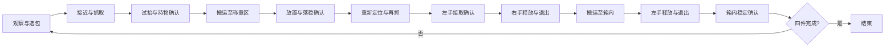
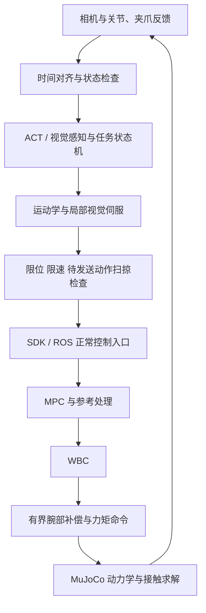

你这次展示可以围绕一个核心认识展开：

**Scene1 是一个分层闭环机器人系统：上层决定下一步操作，中层根据视觉和运动学生成动作，底层通过 MPC、WBC 和力矩控制执行，MuJoCo 则模拟这些动作产生的物理结果，并反馈新的观测。**

项目的工作横跨感知、决策、控制和计算效率。理解它，需要把“目标怎么产生”“关节为什么运动”“物体为什么被抓住”“系统如何判断完成”连接起来。

下面按从基础到整体的顺序展开。通用理论用于解释原理；具体参数和项目结论以本地代码及截至 2026 年 11 月 3 日的记录为依据。

---

**1．先明确：这个项目究竟要解决什么问题**

Scene1 的任务是让机器人连续处理四个包裹。每件包裹需要经历：

**选取 → 抓取 → 称重区放置 → 确认落稳 → 再抓取 → 双手交接 → 放入箱内 → 确认完成。**

难点集中在三个方面：

- **连续性**：第一件完成后，场景已经改变，后续不能机械重复第一次动作。
- **接触变化**：抓取、松手、交接都会改变受力关系，原本稳定的姿态可能突然漂移。
- **部分可观测性**：相机可能被手臂遮挡，看到的轮廓也不一定是完整包裹。

因此，一个关节目标正确，不能直接推出抓取成功；抓取成功，也不能直接推出完整四包任务成功。

当前方案可以称为：

> **基于既有 ACT 策略、视觉反馈和模型控制的分层双臂操作系统。**

其中，首包保留 ACT 与视觉辅助，后续包裹主要由显式视觉闭环和阶段控制完成。没有重新训练 ACT，也不能把当前四包成绩表述为“纯 ACT 模型独立完成”。

---

**2．最基础的一层：机器人在数学上是什么**

机器人首先是由刚体和关节组成的机械系统。

需要区分三个量：

| 量 | 含义 | 例子 |
|---|---|---|
| 关节位置 \(q\) | 每个关节转到了哪里 | 肘关节角度 |
| 关节速度 \(\dot q\) | 关节转动有多快 | 腕部转速 |
| 关节力矩 \(\tau\) | 驱动关节运动的作用力矩 | 电机输出的转矩 |

上层常常说“手向右移动 1 厘米”，但机器人执行时，需要把它转换成若干关节的运动，再由力矩推动这些关节。

还需要区分两个空间：

- **关节空间**：用各关节角度描述姿态。
- **笛卡尔空间，也称任务空间**：用手的位置和朝向描述姿态。

一个手的空间位姿通常有六个自由度：三个位置量、三个方向量。本项目每条手臂有七个关节，因此可能存在多种关节姿态对应相近的手部位姿，这就是运动学冗余。

冗余给避障和避开关节极限提供了选择，也让求解更复杂。

项目使用的机器人描述主要包括：

- **URDF**：描述连杆、关节连接关系、关节轴、几何与限位等。
- **MuJoCo XML/MJCF**：描述仿真中的机器人、物体、执行器、接触和环境。

两种模型中的关节顺序、几何和工具坐标必须一致。否则，即使算法计算完全正确，也可能控制错关节或算错手的位置。

---

**3．仿真原理：MuJoCo 如何让机器人和包裹运动**

本项目底层使用 **MuJoCo**。

它维护机器人、包裹、桌子和箱子的状态，根据控制输入、重力和接触关系，计算下一时刻的运动。

机器人动力学可以概括为：

\[
M(q)\dot v+h(q,v)
=
S^\mathsf{T}\tau+J_c(q)^\mathsf{T}\lambda
\]

这里：

- \(q,v\)：系统的位置与广义速度。
- \(M(q)\)：质量和惯性形成的质量矩阵。
- \(h(q,v)\)：重力、科里奥利力等项。
- \(\tau\)：执行器力矩。
- \(S\)：选择实际受驱动的关节。
- \(J_c^\mathsf{T}\lambda\)：接触产生的作用，例如脚底支撑、夹爪夹持和桌面支撑。

对浮动基座机器人，位置可能用四元数表示，因此 \(q\) 与 \(v\) 的维度不一定相同。

一个仿真步可以理解为：

1. 读取当前状态和控制输入。
2. 计算运动学、动力学和碰撞关系。
3. 求解接触约束产生的力。
4. 得到加速度并进行数值积分。
5. 更新状态，供传感器输出和下一次控制使用。

MuJoCo 的接触计算使用带正则化的约束模型；接触参数会影响物体的滑动、支撑和碰撞响应。[MuJoCo 计算原理](https://mujoco.readthedocs.io/en/latest/computation/)

**包裹为什么能够被抓起来？**

从基本物理上看，夹爪产生法向夹持力，接触摩擦抵抗包裹的下滑和转动。夹持位置、摩擦、包裹重心和搬运加速度都会影响结果。

所以，即使同样发送“闭爪”命令，也可能出现：

- 两指夹住包裹；
- 只有一侧接触；
- 夹在边缘，抬起后旋转；
- 完全闭合，但其实空抓。

这也是项目必须结合夹爪反馈、视觉和试抬过程确认抓取的原因。

**本项目有一个值得展示的建模细节：**

当前场景 XML 中，称重区标记本身关闭碰撞，其下方桌面提供物理支撑。因此，不能把画面中的绿色称重区域理解成一台已经完整模拟传感器读数的电子秤。项目现有证据主要涉及称重区放置与稳定确认，不能据此宣称已实现质量测量。

场景中包裹和箱子也有质量、摩擦和接触参数；它们的运动由物理求解产生。[场景模型](/home/krist/kuavo_course/workspace/leju-kuavo-challenge-cup-2026/src/challenge_cup_simulator/models/biped_s52/xml/scene1.xml)

---

**4．仿真时间、控制频率和实际耗时为什么不同**

这是理解提速工作的基础。

| 概念 | 表示什么 |
|---|---|
| 仿真步长 | 一次数值积分推进多少模拟时间 |
| 控制频率 | 某层控制器计划每秒更新多少次 |
| 墙钟时间 | 现实世界实际过去的时间 |

官方场景启动配置中，WBC 与传感器频率设为 **1000 Hz**；仿真节点根据频率设置物理步长。项目保存的 MPC 配置为目标 **50 Hz**、预测时域 **1 秒**。这些是配置值，不保证机器实际始终达到对应吞吐率。

上层视觉策略的频率更低，提速方案按阶段使用约 10～20 Hz 等不同节奏。

这形成了一个多频率系统：

> 底层高频处理动力学和跟踪，上层较低频处理图像、任务状态和动作目标。

例如，仿真推进 1 秒，如果计算、通信和等待耗费 2 秒，那么实际运行速度只有实时的约一半。

可以用：

\[
\text{实时因子}=\frac{T_{\text{sim}}}{T_{\text{wall}}}
\]

描述这种关系。

因此：

- 动作步数减少，不一定让实际耗时同比减少。
- WBC 求解变快，不一定消除视觉等待。
- CPU 频率提高，也不一定改善整套程序的线程调度与吞吐。

**本项目的 600 秒目标按实际墙钟计时**，正式运行中的计算和等待都计入。

---

**5．最底层控制：目标位置如何变成实际运动**

控制系统需要持续比较“希望机器人处于什么状态”和“机器人实际处于什么状态”。

最基础的反馈形式是 PD 控制：

\[
\tau_{\text{PD}}
=
K_p(q_{\text{ref}}-q)
+
K_d(\dot q_{\text{ref}}-\dot q)
\]

其中：

- 比例项根据位置误差推动关节接近目标。
- 微分项根据速度误差提供阻尼，抑制过冲和振荡。

但是，人形机器人有重力、连杆耦合和接触约束，因此整个系统不能仅用一个 PD 公式解释。项目的主要控制链还包括 MPC 和 WBC。

需要特别区分：

| 信号 | 含义 |
|---|---|
| 上层发送目标 | ACT 或视觉控制器希望手臂到达的关节状态 |
| WBC 使用的参考 | 经底层处理后参与控制计算的参考状态 |
| 实际反馈 | 仿真机器人真正达到的关节状态 |
| 输出力矩 | 用来推动机器人运动的执行量 |

**这些信号不会天然相等。**

本项目当前 MuJoCo ROS 接收路径读取关节消息中的力矩，并写入执行器控制量。因此，不能把“发送关节角目标”理解成“直接把仿真关节改到那个角度”。[仿真控制接口](/home/krist/kuavo_course/workspace/leju-kuavo-challenge-cup-2026/src/mujoco/src/mujoco_node.cc:1618)

这也是项目需要同时记录目标、反馈和力矩的原因：只有看清误差发生在哪一层，才能选对修复位置。

---

**6．MPC：根据模型预测未来，再不断重新规划**

MPC 是模型预测控制。

它在每次更新时：

1. 读取当前状态。
2. 使用模型预测未来一段时间。
3. 在目标和约束下优化控制序列。
4. 应用当前需要的部分。
5. 收到新反馈后再次求解。

一个通用表达为：

\[
\min_{\{u_k\}}
\sum_{k=0}^{N-1}
\left(
\|x_k-x_k^{\text{ref}}\|_Q^2+
\|u_k\|_R^2
\right)
+\Phi(x_N)
\]

同时满足系统动力学和相应约束。

它权衡的是：如何接近目标、控制动作是否过大，以及未来运动是否可行。Kuavo 控制栈使用 OCS2，其提供动力学、代价函数、约束和最优控制求解接口。[OCS2 原理与接口](https://leggedrobotics.github.io/ocs2/optimal_control_modules.html)

**在本项目中的理解重点：**

MPC 属于机器人运动控制层，不负责从图像中识别包裹，也不直接决定四包任务的阶段顺序。

配置中保留 `direct_to_wbc: false`，沿用正常控制入口。

同时，MPC 与 WBC 使用的模型维度不必完全一致。项目保存的配置允许 MPC 简化手臂自由度，而 WBC 和实际手臂仍处理完整关节。因此，不能画成“14 个手臂关节都在每个 MPC 问题中以相同形式被优化”。

---

**7．WBC：把运动目标转化成满足动力学的全身控制**

WBC 是全身控制。

即使任务主要是双臂抓取，手臂和包裹的运动也会影响身体受力。因此，底层需要协调手臂、身体姿态和支撑关系。

本项目使用 `WeightedWbc`，可以用下面的二次规划形式解释：

\[
\min_z \frac{1}{2}z^\mathsf{T}Hz+g^\mathsf{T}z
\]

满足：

\[
A_{\text{eq}}z=b_{\text{eq}},
\qquad
A_{\text{ineq}}z\le b_{\text{ineq}}
\]

决策量包括广义加速度、接触力和关节力矩。不同任务通过权重组合，动力学和相应边界通过约束表达。

MPC 和 WBC 的区别可以这样讲：

| 层级 | 主要关注 |
|---|---|
| MPC | 在预测时间段内，运动应该如何演化 |
| WBC | 当前这一刻，如何协调全身加速度、接触力与力矩 |
| 上层视觉控制 | 手相对包裹还有多少误差，应该如何调整 |
| 任务状态机 | 当前应抓取、称重、交接还是入箱 |

WBC 内部也会使用反馈任务，因此这些层级并不是完全孤立的模块，而是嵌套反馈关系。[WBC 接口定义](/home/krist/kuavo_course/workspace/leju-kuavo-challenge-cup-2026/installed/include/humanoid_wbc/WbcBase.h)

**为什么 WBC 已经存在，腕部仍可能有误差？**

因为实际跟踪还受到任务权重、模型误差、参考滤波、执行延迟、负载变化和约束的影响。

有一个优化器，并不意味着所有目标都能瞬时、无误差地达到。

---

**8．本项目底层的两项关键改动：A 和 C**

这部分最适合展示“我们具体解决了什么”。

**A：修复手臂参考点索引。**

原代码以固定偏移提取手臂状态：

```cpp
observation_.state.segment(24, 14)
```

在该机器人状态布局中，腰部关节使固定起点发生错位：提取结果会包含腰部并漏掉末端腕关节。

修正为：

```cpp
observation.state.tail(14)
```

这项修改解决的是输入语义正确性：

> 控制器收到的“手臂当前状态”，必须确实对应完整的 14 个手臂关节。

再好的控制算法，也无法补救错误的关节映射。[A 修改记录](/home/krist/scene1-ac-speed/controllers/candidate-reference-origin/change.patch)

**C：在 WBC 输出后增加有界腕部 PD 补偿。**

对双臂共六个腕关节，增加：

\[
\Delta\tau
=
\operatorname{clip}
\left(
1.0(q_{\text{WBC}}-q_{\text{actual}})
-0.05\dot q_{\text{actual}},
-0.5,\;0.5
\right)
\]

并对合成后的力矩继续限幅。

它针对的是 WBC 参考到实际腕部反馈之间的跟踪误差。这里使用的是速度阻尼项，没有额外积分项或新增重力项。

该补偿在代码中限定为仿真及相应控制模式；附加力矩限制为 ±0.5 N·m，腕部合成命令限制为 ±14.1 N·m。

历史对照支持腕部跟踪改善，但部分近端关节误差增加。因此展示时应同时说明收益和代价。[C 修改记录](/home/krist/scene1-ac-speed/controllers/candidate-wrist-pd/change.patch)

另外，**已发布 A+C 版的 C 补偿没有修改 WBC 内部 QP；11 月研发候选随后又进行了 WBC 求解实现优化。** 两个阶段要分开介绍。

---

**9．运动学与视觉伺服：如何把“手偏了几毫米”转成关节修正**

这一层连接视觉和底层控制。

**正运动学 FK** 回答：

> 已知关节角度，手在哪里？

\[
T_{\text{base}\rightarrow\text{tool}}=f(q)
\]

**逆运动学 IK** 回答：

> 已知想要的手部位姿，关节应如何配置？

IK 还需要考虑关节限位、姿态误差和当前姿态，结果可能不唯一，也可能在约束下找不到可接受解。

项目直接从公开 URDF 构造手臂链，并加入夹爪工具偏移。工具中心不是腕关节原点，忽略这个偏移会造成系统性的抓取误差。[运动学实现](/home/krist/scene1-ac-speed/scene1/kinematics.py)

局部运动可以用雅可比矩阵表达：

\[
\Delta x\approx J(q)\Delta q
\]

其中 \(\Delta x\) 是希望修正的末端位置和方向，\(\Delta q\) 是关节小幅变化。

视觉伺服则反复执行：

> 观察实际误差 → 计算小步修正 → 检查约束 → 发送 → 再观察。

本项目使用分阶段的笛卡尔闭环和受限关节修正。这种方式能根据实际反馈纠正误差，但也会受到视觉噪声和控制延迟影响。

所以，**位置进入容差范围只是到位条件的一部分**。如果手正在高速穿过目标，立刻进入下一阶段可能导致松手后失稳。还需要检查运动量和持续稳定时间。

---

**10．视觉感知：机器人如何知道包裹和称重台在哪里**

视觉链需要把像素变成具有空间含义的几何信息。

RGB 图像提供颜色和轮廓；深度图提供距离。在深度值表示光轴方向深度、像素已正确对齐的前提下：

\[
X_c=\frac{u-c_x}{f_x}Z,\qquad
Y_c=\frac{v-c_y}{f_y}Z,\qquad
Z_c=Z
\]

随后通过相机外参，把点转换到机器人基座坐标系：

\[
p_{\text{base}}
=
T_{\text{base}\leftarrow\text{camera}}p_{\text{camera}}
\]

这要求三个条件成立：

- 相机内参和深度解释正确；
- 相机与机器人之间的坐标变换正确；
- 图像与用于变换的关节反馈在时间上足够一致。

头部转动时，相机坐标系也在变化。若使用过期的关节姿态，就可能把相机运动误认为包裹移动。

**本项目主要使用显式几何与图像处理：**

- 颜色和连通区域筛选候选；
- 深度点云提取台面与物体几何；
- 使用尺寸、边缘和支撑关系排除误检；
- 结合腕部图像检查接近、插入和接取；
- 利用多帧一致性确认状态稳定。

这是当前颜色和几何受限场景下的感知方案，其泛化范围与通用物体识别模型不同。

还要区分两种“真值”：

- 仿真器内部必须知道物体位置，才能计算物理和渲染。
- 策略获得物体位置，依靠允许使用的相机和传感器观测。

**仿真器掌握物体真值，不代表策略可以读取物体真值。**

---

**11．ACT 在整个项目中承担什么角色**

ACT 全称是 **Action Chunking with Transformers**。

它属于模仿学习：从示范数据学习观测到动作的映射，并一次预测未来一段动作：

\[
(a_t,a_{t+1},\ldots,a_{t+H-1})=\pi_\theta(o_t)
\]

动作分块有助于建模连续操作。时间集成则可以融合不同预测时刻对同一执行时刻的动作预测，以减少不连续。[ACT 原论文](https://arxiv.org/abs/2304.13705)

本项目沿用原有 ACT 权重及预处理、后处理，动作维度是：

```text
左臂 7 关节 + 左夹爪 1 维 + 右臂 7 关节 + 右夹爪 1 维
```

总计 16 维。

理解项目演进时，需要抓住这一点：

> ACT 提供了已有操作能力，但完整任务中的关键接触事件和后续包裹处理，需要更明确的反馈确认与阶段管理。

历史运行中，首包完成后恢复 ACT，出现过继续朝原首包空位闭爪的现象。它不能仅凭一次观察就归因于时间融合，但说明已有策略在场景变化后的行为不足以保证完整任务。

因此，现在采用混合控制：

- 首包部分过程由 ACT 配合视觉辅助。
- 再抓后的交接、入箱由视觉控制接管。
- 后续包裹选择、抓取及完整循环主要由显式视觉流程控制。

展示时应把**基础模型贡献**与**本项目新增的闭环控制贡献**讲清楚。

---

**12．状态机：如何把多个动作组织成完整四包任务**

状态机负责管理“现在处于哪一步”和“何时可以进入下一步”。



每个状态至少有：

- 目标动作；
- 所需观测；
- 进入下一状态的条件；
- 超时或异常处理。

例如交接阶段，不能只按时间顺序“左手闭合，然后右手张开”，还要确认左手已经形成有效接取。

放置阶段也需要区分：

1. 已发送张爪命令；
2. 夹爪已张开；
3. 包裹已经落稳；
4. 手退出后包裹仍稳定。

这些状态之间存在真实的物理过程，不能合并成一个软件标志。

最新“四件独立入箱”验收要求，为每一件保留互不复用的选取、称重、再抓、接取、箱内释放、退手和稳定证据。已经取消此前候选额外使用的堆叠层高要求，但不能把旧失败记录重新判为成功。[视觉循环实现](/home/krist/scene1-ac-speed/scene1/visual_cycle.py)

---

**13．把系统整体连接起来：一次动作如何完成闭环**



这是双臂主要控制链的概括。夹爪与头部还有对应控制接口，并非所有信号都通过同一套 MPC 优化。

软件部署上：

- 算法容器运行 ACT、视觉处理与任务流程；
- 仿真容器运行官方场景与控制栈；
- ROS 传递观测、目标和反馈；
- 宿主机工具负责独立复位、监控、计时、归档与恢复。

Docker 提供运行环境隔离，ROS 提供通信。二者都不能自动保证数据新鲜或实时性能。

这也是为什么机器人问题有时来自算法，有时来自队列延迟、线程争用和日志写盘。

---

**14．安全与完成检查为什么会影响速度**

项目存在多层检查，它们的作用不同。

| 检查 | 解决的问题 |
|---|---|
| 关节位置与速度边界 | 防止命令越界或变化过快 |
| 力矩与补偿监控 | 防止持续超限 |
| 数据新鲜度检查 | 防止用过期反馈控制 |
| 路径扫掠检查 | 防止运动中途穿过障碍物 |
| 夹持和接取检查 | 防止空抓或交接掉落 |
| 支撑与落稳检查 | 防止过早松手或再抓 |
| 入箱证据检查 | 防止把已有物体误算为新完成件 |

尤其需要理解：

> **终点可达，不代表到终点的路径安全。**

某个 IK 解可能在关节限位内，但手指在途中会扫过包裹或箱壁。

而且应检查实际经过滤波、限速后准备发送的命令，不能只检查上层理想路径。项目曾遇到旧反馈造成扫掠检查不可靠的问题，后续改为在发送前读取新反馈复核。

这些检查提供的是其模型和观测范围内的保护证据，不能表述为数学上证明了整台机器人在所有条件下绝对安全。

---

**15．为什么项目能提速，又为什么继续提速很难**

总耗时可以按不同来源理解：

\[
T_{\text{total}}
=
T_{\text{动作执行}}
+
T_{\text{感知与计算}}
+
T_{\text{通信与等待}}
+
T_{\text{重复观察及纠偏}}
\]

实际程序存在并行与重叠，定位瓶颈时需要看关键路径，不能简单相加所有线程的计时。

已经实施的优化主要有：

| 方向 | 项目中的做法 | 作用 |
|---|---|---|
| 控制正确性 | A 索引修复 | 避免错误参考进入控制链 |
| 跟踪性能 | C 腕部有界补偿 | 改善关键阶段腕部误差 |
| 感知计算 | 原生连通分组、局部处理、复用同帧计算 | 降低循环开销 |
| 运动学计算 | 精确状态缓存、解析雅可比、原生求解辅助 | 减少重复求解 |
| 动作节奏 | 分阶段频率、增益和等待策略 | 减少低效收敛 |
| 任务流程 | 减少不必要回位和重复观察 | 缩短操作过程 |
| 系统运行 | 线程布局、本地日志暂存、结束后归档 | 减少调度与磁盘阻塞 |

最新研发还尝试了 **WBC 热启动与等式约束消元**。

若原问题有：

\[
A_{\text{eq}}z=b
\]

可以写成：

\[
z=z_p+Ny
\]

其中 \(z_p\) 满足等式，\(N\) 张成等式约束的零空间。这样只需求更低维的 \(y\)，最后恢复完整解并检查原约束。

项目记录中，某些成功运行将 QP 从 **84 个变量降到 51 个变量**。这项改动利用问题结构减少计算，没有取消原约束。[研发求解器实现](/home/krist/scene1-ac-speed/controllers/candidate-wbc-reduced/scene1_reduced_wbc.h)

但局部求解变快之后，瓶颈可能转移到：

- 视觉处理；
- 末端到位与稳定等待；
- 接触过程；
- 仿真线程；
- 入箱后的观测确认。

继续增大步长或提高频率，可能反而产生过冲、视觉失配和保护停止。因此，提速需要同时处理计算效率与闭环动态特性。

---

**16．如何评价项目成果，以及展示时应该怎样表达**

截至最新留档：

| 版本或阶段 | 结果 | 可以支持的结论 |
|---|---|---|
| 原 A+C v1 | 四个 seed 四包完成，均值约 34分31秒 | 该版本已有多场景完整执行证据 |
| 已发布提速版 | seed 0、3、4，约 14分14秒～14分42秒 | 同一冻结版本三轮低于15分钟 |
| 历史最快研发候选 | seed 4，621.87秒 | 单个开发种子接近10分钟 |
| 最新独立入箱候选 | seed 4，650.47秒 | 新验收口径下四条独立证据链通过 |
| 10个随机种子、全部低于600秒 | 0/10 | 最终目标尚未完成 |

这些结果中的 `task_success` 均为 `null`，应称为项目定义的视觉、流程与运行检查通过，不能称为官方裁判已经判定成功。[项目结果与边界](/home/krist/scene1-ac-speed/README.md)

展示时，可以用下面这段话概括你的理解：

> 我把 Scene1 理解为一个多层闭环系统。MuJoCo 负责模拟机器人与物体的物理交互，MPC 和 WBC 负责把运动参考转换成底层控制，视觉与运动学负责修正实际操作误差，ACT 提供已有的示范学习能力，状态机负责组织完整四包流程。项目优化需要沿着这条链分析：目标是否正确、反馈是否新鲜、执行是否跟得上、接触是否稳定，以及每一件是否有完整完成证据。我们已经把已发布版本的四包耗时从约34分钟降到约14分半，研发候选进一步接近10分钟，但随机多种子的最终验收仍未完成。

用于展示的内容顺序可以压缩成八页：

1. **任务与难点**：为什么四包连续操作比单次抓取复杂。
2. **整体系统图**：策略、控制、仿真和反馈如何连接。
3. **仿真与物理**：动力学、接触、摩擦和时间概念。
4. **底层控制**：MPC、WBC、力矩反馈各自负责什么。
5. **感知与动作生成**：RGB-D、坐标变换、FK/IK、视觉伺服。
6. **任务组织**：ACT 与状态机如何协作。
7. **项目贡献**：A/C、计算优化与分阶段提速。
8. **结果与边界**：已验证成绩、失败经验、剩余目标。